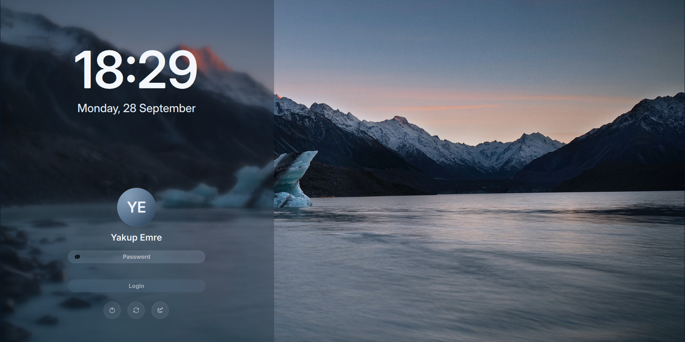

# yakupemre-sddm

A calm SDDM login screen: a glacier lake at dusk, a frosted side panel, Inter type, your own avatar and three quiet power buttons.

[](LICENSE)


[](https://github.com/YakupEmreYerli/yakupemre-sddm/actions/workflows/ci.yml)

> Türkçe: [README.tr.md](README.tr.md)



## Sibling project

This is the login screen half of a pair. The lock screen is **[yakupemre-lockscreen](https://github.com/YakupEmreYerli/yakupemre-lockscreen)**: same background, palette, clock and form for Plasma 6. Install both and the screen you see after boot, after `Meta+L` and after waking up is the same one.

## What's different

This theme is built on [sddm-astronaut-theme](https://github.com/Keyitdev/sddm-astronaut-theme) by Keyitdev. The layout engine is the same; the login flow and look are reworked:

- **No username box.** The last user is preselected and shown by name, you only type a password.
- **Your avatar, round.** Read from SDDM's user model (AccountsService icon or `FacesDir`), cropped to a circle. Falls back to a plain glyph.
- **Three power buttons.** Shut down, restart, sleep as round glass buttons; labels appear on hover. Hibernate is gone.
- **No session picker, no on-screen keyboard button.** Plasma is assumed; the virtual keyboard is off.
- **Inter everywhere**, a large Inter Display clock and a glacier-blue palette tuned to the background.
- **English and Turkish** configs (`Themes/en.conf`, `Themes/tr.conf`).

## Requirements

- SDDM 0.21 or newer with the Qt 6 greeter (`sddm-greeter-qt6`)
- Qt 6.5+ with `qt6-declarative`, `qt6-svg` (for `QtQuick.Effects`)
- The [Inter](https://rsms.me/inter/) font (`inter-font` on Arch)

On Arch Linux:

```bash
sudo pacman -S --needed sddm qt6-svg qt6-declarative inter-font
```

## Install

```bash
git clone https://github.com/YakupEmreYerli/yakupemre-sddm.git
cd yakupemre-sddm
sudo ./install.sh            # English
sudo ./install.sh --lang tr  # Türkçe
```

`install.sh` copies the theme to `/usr/share/sddm/themes/yakupemre-sddm` and writes `/etc/sddm.conf.d/50-yakupemre-sddm.conf` with `Current=yakupemre-sddm`. Use `--no-activate` to install without switching.

Preview without logging out:

```bash
sddm-greeter-qt6 --test-mode --theme /usr/share/sddm/themes/yakupemre-sddm
```

The test window renders the real layout; [`Previews/preview.jpg`](Previews/preview.jpg) was taken this way.

## Avatar

SDDM's greeter runs as the `sddm` user and usually cannot read `~/.face.icon` in a private home directory. Put the picture where it can:

```bash
sudo cp my-avatar.png /var/lib/AccountsService/icons/$USER
```

KDE System Settings → Users does this for you.

## Customizing

Everything lives in the active config file. Common keys:

| Key | Default | Notes |
| --- | --- | --- |
| `Background` | `Backgrounds/glacier-lake.jpg` | Relative path; png, jpg, webp, gif, mp4, webm |
| `Font` | `Inter` | Any installed family |
| `FormPosition` | `left` | `left`, `center`, `right` |
| `PartialBlur` | `true` | Frosted panel behind the form |
| `DateFormat` | `dddd, d MMMM` | Qt date format |
| `Locale` | *(system)* | e.g. `en_US`, `tr_TR` |

The full list with comments is in [`Themes/en.conf`](Themes/en.conf).

## Project layout

```
Main.qml            entry point (from sddm-astronaut-theme)
Components/         clock, password form, power buttons, keyboard
Assets/             icons
Backgrounds/        glacier-lake.jpg
Themes/             en.conf (English), tr.conf (Turkish)
install.sh          installer
```

## Credits

- Theme base: [sddm-astronaut-theme](https://github.com/Keyitdev/sddm-astronaut-theme) by Keyitdev (GPL-3.0), itself based on [sddm-sugar-dark](https://github.com/MarianArlt/sddm-sugar-dark) by MarianArlt.
- Power icons: [Breeze](https://invent.kde.org/frameworks/breeze-icons) by KDE (LGPL-3.0).
- Background: glacier lake photo from the [dharmx/walls](https://github.com/dharmx/walls) collection. The original photographer is not credited there; if this is your work, open an issue and it will be credited or removed.

## License

GPL-3.0-or-later, same as the theme it is based on. See [LICENSE](LICENSE).
