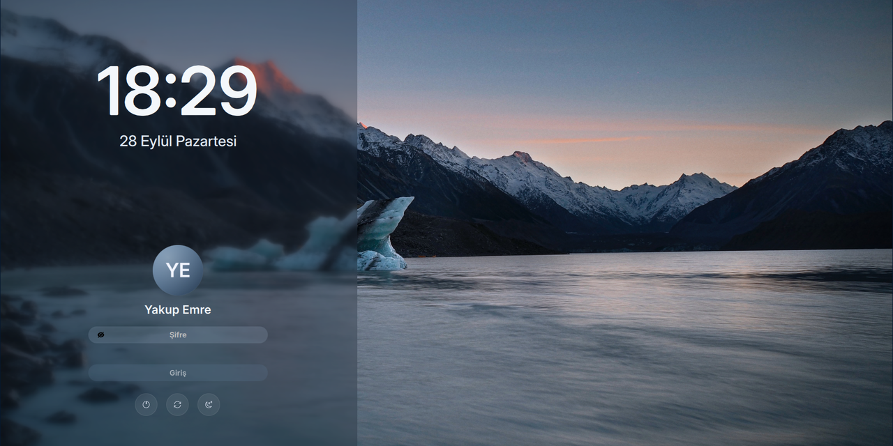

# yakupemre-sddm

Sakin bir SDDM giriş ekranı: alacakaranlıkta bir buzul gölü, buzlu cam bir yan panel, Inter yazı tipi, kendi avatarınız ve göze batmayan üç güç düğmesi.

[](LICENSE)


[](https://github.com/YakupEmreYerli/yakupemre-sddm/actions/workflows/ci.yml)

> English: [README.md](README.md)



## Kardeş proje

Bu, bir ikilinin giriş ekranı tarafı. Kilit ekranı tarafı **[yakupemre-lockscreen](https://github.com/YakupEmreYerli/yakupemre-lockscreen)**: Plasma 6 için aynı arka plan, renk paleti, saat ve form. İkisini birden kurarsanız açılışta, `Meta+L`'den sonra ve uykudan uyanınca karşınıza hep aynı ekran çıkar.

## Neler farklı

Bu tema Keyitdev'in [sddm-astronaut-theme](https://github.com/Keyitdev/sddm-astronaut-theme) teması üzerine kurulu. Yerleşim motoru aynı, giriş akışı ve görünüm ise yeniden yapıldı:

- **Kullanıcı adı kutusu yok.** Son kullanıcı seçili gelir ve adıyla görünür; yalnızca şifrenizi yazarsınız.
- **Avatarınız, yuvarlak.** SDDM'nin kullanıcı modelinden (AccountsService simgesi ya da `FacesDir`) okunur ve daire biçiminde kırpılır. Resim yoksa yerine sade bir simge çıkar.
- **Üç güç düğmesi.** Kapat, yeniden başlat ve uyku, yuvarlak cam düğmeler olarak duruyor; adları fareyle üstlerine gelince görünür. Hazırda bekletme kaldırıldı.
- **Oturum seçici de ekran klavyesi düğmesi de yok.** Plasma kullandığınız varsayılır, sanal klavye kapalı.
- **Her yerde Inter**, büyük bir Inter Display saat ve arka plana göre ayarlanmış buzul mavisi bir palet.
- **İngilizce ve Türkçe** ayar dosyaları (`Themes/en.conf`, `Themes/tr.conf`).

## Gerekenler

- Qt 6 karşılama ekranıyla (`sddm-greeter-qt6`) SDDM 0.21 ya da daha yenisi
- `qt6-declarative` ve `qt6-svg` ile Qt 6.5+ (`QtQuick.Effects` için)
- [Inter](https://rsms.me/inter/) yazı tipi (Arch'ta `inter-font`)

Arch Linux'ta:

```bash
sudo pacman -S --needed sddm qt6-svg qt6-declarative inter-font
```

## Kurulum

```bash
git clone https://github.com/YakupEmreYerli/yakupemre-sddm.git
cd yakupemre-sddm
sudo ./install.sh            # İngilizce
sudo ./install.sh --lang tr  # Türkçe
```

`install.sh` temayı `/usr/share/sddm/themes/yakupemre-sddm` klasörüne kopyalar ve `Current=yakupemre-sddm` satırıyla `/etc/sddm.conf.d/50-yakupemre-sddm.conf` dosyasını yazar. Temaya geçmeden yalnızca kurmak için `--no-activate` ekleyin.

Oturumu kapatmadan önizlemek için:

```bash
sddm-greeter-qt6 --test-mode --theme /usr/share/sddm/themes/yakupemre-sddm
```

Test penceresi gerçek yerleşimi çizer; [`Previews/preview.jpg`](Previews/preview.jpg) bu yolla alındı.

## Avatar

SDDM'nin karşılama ekranı `sddm` kullanıcısıyla çalışır ve başkalarına kapalı bir ev dizinindeki `~/.face.icon` dosyasını çoğu zaman okuyamaz. Resmi okuyabileceği bir yere koyun:

```bash
sudo cp my-avatar.png /var/lib/AccountsService/icons/$USER
```

KDE Sistem Ayarları → Kullanıcılar bunu sizin yerinize yapar.

## Özelleştirme

Her şey etkin ayar dosyasında. Sık kullanılan anahtarlar:

| Anahtar | Varsayılan | Not |
| --- | --- | --- |
| `Background` | `Backgrounds/glacier-lake.jpg` | Göreli yol; png, jpg, webp, gif, mp4, webm |
| `Font` | `Inter` | Kurulu herhangi bir yazı tipi ailesi |
| `FormPosition` | `left` | `left`, `center`, `right` |
| `PartialBlur` | `true` | Formun arkasındaki buzlu cam panel |
| `DateFormat` | `dddd, d MMMM` | Qt tarih biçimi |
| `Locale` | *(sistem)* | örneğin `en_US`, `tr_TR` |

Açıklamalarıyla birlikte tam liste [`Themes/en.conf`](Themes/en.conf) dosyasında.

## Proje düzeni

```
Main.qml            giriş noktası (sddm-astronaut-theme'den)
Components/         saat, şifre formu, güç düğmeleri, klavye
Assets/             simgeler
Backgrounds/        glacier-lake.jpg
Themes/             en.conf (İngilizce), tr.conf (Türkçe)
install.sh          kurulum betiği
```

## Emeği geçenler

- Temanın temeli: Keyitdev'in [sddm-astronaut-theme](https://github.com/Keyitdev/sddm-astronaut-theme) teması (GPL-3.0); o da MarianArlt'ın [sddm-sugar-dark](https://github.com/MarianArlt/sddm-sugar-dark) temasına dayanıyor.
- Güç simgeleri: KDE'nin [Breeze](https://invent.kde.org/frameworks/breeze-icons) simgeleri (LGPL-3.0).
- Arka plan: [dharmx/walls](https://github.com/dharmx/walls) koleksiyonundaki buzul gölü fotoğrafı. Orada fotoğrafçının adı geçmiyor; fotoğraf sizinse bir issue açın, adınız eklenir ya da fotoğraf kaldırılır.

## Lisans

Dayandığı tema gibi GPL-3.0-or-later. Bkz. [LICENSE](LICENSE).
